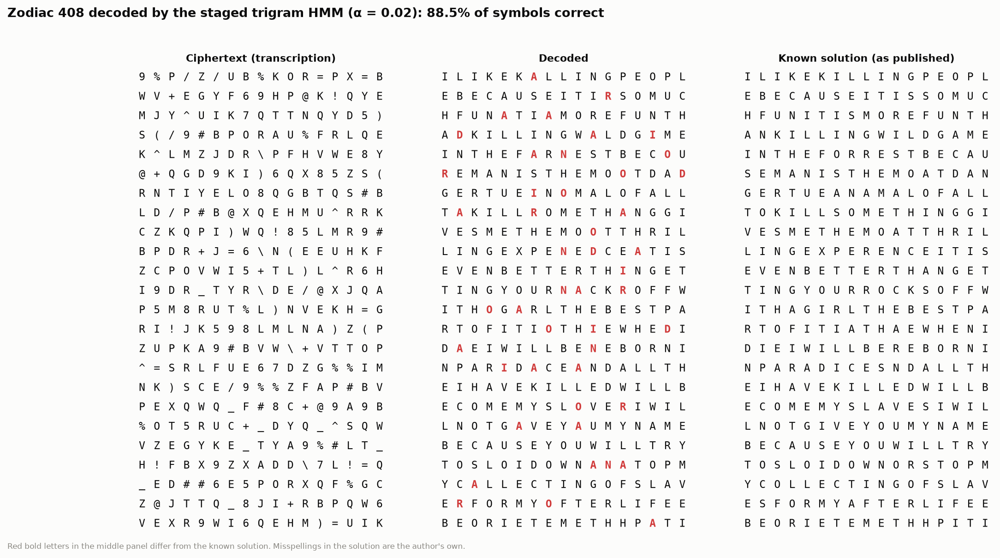
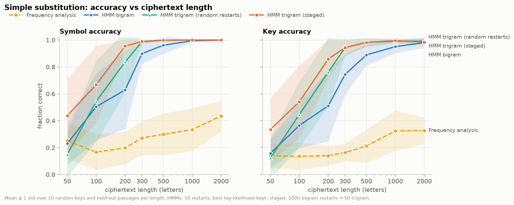
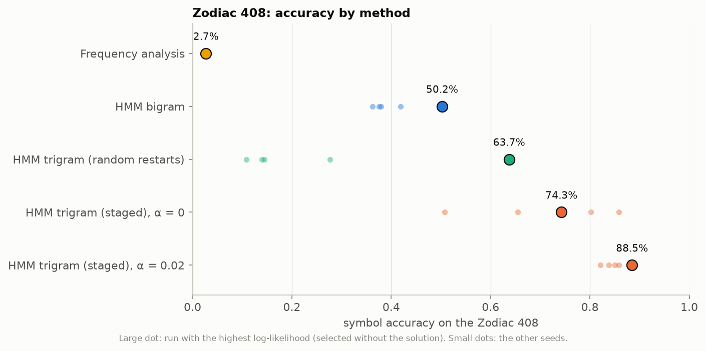

# Unsupervised Decipherment of Substitution Ciphers with Hidden Markov Models

A pattern recognition course project that breaks classical substitution ciphers with a
Hidden Markov Model. The model is **unsupervised**: it sees only the ciphertext and an
English letter model, never the key or any plaintext/ciphertext pairs.

Results in short:

* **Simple substitution:** the trigram HMM reads 95% of a 200-letter ciphertext correctly
  and 99.8% from 500 letters; frequency analysis stays below 45%.
* **Homophonic substitution** (up to 70 symbols): 99% at 1000 letters.
* **Zodiac 408** (the real 1969 cipher, 54 symbols, no word breaks): **88.5%** of the
  408 symbols decoded correctly, with all settings chosen on synthetic ciphers and the
  run picked by likelihood alone. Frequency analysis gets 2.7%.



---

## Contents

1. [How it works](#how-it-works)
2. [Setup](#setup)
3. [Running everything](#running-everything)
4. [Results](#results)
5. [Mapping to course topics](#mapping-to-course-topics)
6. [Project layout](#project-layout)
7. [Design decisions and deviations from the plan](#design-decisions-and-deviations-from-the-plan)
8. [Limitations and future work](#limitations-and-future-work)
9. [Data sources](#data-sources)

---

## How it works

### The model

| HMM part | In this project |
|---|---|
| Hidden states | plaintext letters a–z (26 states), or letter pairs for the trigram model (676 states) |
| Observations | cipher symbols, any alphabet size (26 for simple substitution, 54 for the Zodiac 408) |
| Initial distribution π | English letter frequencies, because test passages start mid-text |
| Transitions A | English letter bigram (or trigram) model trained on 13.7 M letters of Gutenberg text, **kept fixed** |
| Emissions B | P(cipher symbol \| plaintext letter): **the unknown key**, learned with Baum-Welch |

Decipherment is maximum-likelihood (or MAP) estimation of B with A and π held fixed:

$$\hat B = \arg\max_B \; \log P(o_{1:T} \mid \pi, A, B) \;[+\; \log p(B)]$$

Since A encodes English, the only way to make the ciphertext likely is to map its
symbols onto letters so that the implied plaintext looks like English.

### Algorithms (all in NumPy, written from scratch)

* **Forward and backward** with per-step normalization to avoid underflow; the
  log-likelihood is the sum of the log normalizers. All random restarts run as one
  vectorized batch.
* **Baum-Welch with fixed transitions.** E-step: letter posteriors
  γ<sub>t</sub>(k) = P(x<sub>t</sub> = k | o). M-step, with an optional symmetric
  Dirichlet prior (pseudo-count α):

  $$b_{ks} = \frac{\sum_t \gamma_t(k)\,[o_t = s] + \alpha}{\sum_t \gamma_t(k) + S\alpha}$$

  α = 0 is maximum likelihood. α > 0 is the MAP estimate under a Dirichlet(α + 1) prior.
  EM stops when the objective gains less than 10⁻⁵ per symbol, or after a maximum
  number of iterations.
* **Viterbi** in log space, and **posterior (max-marginal) decoding**.
* **Trigram model** with letter-pair states (a, b). Only transitions (a, b) → (b, c)
  exist, so each 676 × 676 step is computed as a batched 26 × 26 × 26 product (26 times
  cheaper). Emissions are tied to the current letter, so B stays 26 × S.
* **Random restarts.** EM has many local optima, so many random initializations of B
  are run and the one with the highest log-likelihood is kept. The log-likelihood of
  every restart is logged.
* **Staged bigram → trigram decipherment.** Trigram EM from random starting points
  rarely finds the good optima (28% on the Zodiac). So: run many cheap bigram restarts,
  then start trigram EM from the best bigram solutions. See
  [design decisions](#design-decisions-and-deviations-from-the-plan).
* **Key extraction.** From the best model, the expected letter/symbol counts
  N<sub>ks</sub> = Σ<sub>t</sub> γ<sub>t</sub>(k)[o<sub>t</sub> = s] give a consistent
  key. For simple substitution it is the one-to-one Hungarian assignment
  (`scipy.optimize.linear_sum_assignment`) maximizing Σ N, which is the expected number
  of correctly decoded positions. For homophonic ciphers each symbol takes its most
  likely letter.

---

## Setup

Python 3.10+ (developed with 3.12). Create the virtualenv **outside** the project folder,
then install the requirements:

```bash
python3 -m venv ~/.venvs/cipher-hmm
```

```bash
source ~/.venvs/cipher-hmm/bin/activate
```

```bash
cd cipher-hmm && pip install -r requirements.txt
```

Activate it again (`source ~/.venvs/cipher-hmm/bin/activate`) in every new terminal before
running the commands below.

> **macOS with iCloud Desktop & Documents:** if the project sits in an iCloud-synced folder
> (Desktop or Documents), macOS may offload files to the cloud and leave placeholders.
> Python then stalls for minutes while each library file downloads, so the demo and tests
> appear to hang. Keeping the virtualenv in `~/.venvs` (not synced) avoids this. For the
> project itself, right-click its folder in Finder and choose **Keep Downloaded**, or keep
> it in a folder outside iCloud.

Dependencies: numpy, scipy, matplotlib, pandas, tqdm, streamlit, pytest, requests, and
hmmlearn (used **only** in one test, to cross-check the forward algorithm).

The trained language models (`data/lm_*.npz`), the held-out test texts and the Zodiac
files are included, which is all the demo and the experiments need. The training corpus
itself (about 50 MB with the raw books) is not in git. Rebuild it, and retrain the
models, from Project Gutenberg (about 20 MB download, about a minute):

```bash
python -m src.corpus
python -m src.lm
```

---

## Running everything

All commands are run from `cipher-hmm/` with the virtualenv active.

### Tests

```bash
pytest -m "not slow"
```

```bash
pytest
```

The first runs the 70 fast tests in about 10 s; the second adds the end-to-end accuracy
test (about 90 s). The tests cover:

* forward likelihood, Viterbi path and posteriors against brute-force enumeration
  (3 states, 4 symbols; also for the trigram model);
* forward vs backward likelihood, and no underflow on 20,000 symbols;
* a log-likelihood (or MAP objective) that never decreases under Baum-Welch;
* agreement with `hmmlearn` on likelihood and Viterbi path;
* the bigram HMM reaching above 90% mean accuracy on ten fixed 1000-letter simple
  substitution ciphers (measured mean: 95.0%);
* corpus cleaning, train/test disjointness, the language models, cipher generation,
  metrics, the Zodiac data, and the demo.

### Decipher something from Python

```python
import numpy as np
from src.ciphers import encrypt, homophonic_key
from src.corpus import sample_passages
from src.decipher import DecipherConfig, decipher, decipher_staged
from src.lm import get_bigram, get_trigram, indices_to_text, text_to_indices

rng = np.random.default_rng(0)
plain = text_to_indices(sample_passages(1, 400, seed=0)[0])
cipher = encrypt(plain, homophonic_key(54, get_bigram().pi, rng), rng)

result = decipher_staged(cipher, 54, get_bigram(), get_trigram(),
                         DecipherConfig(alpha=0.02), n_pool=200, n_keep=10)
print(indices_to_text(result.decoded))   # about 15 s on a laptop
```

### Experiments

Each experiment is a script in `experiments/` that writes CSVs and PNG plots to
`results/`. Every script accepts `--quick` (a tiny smoke test written to `*_quick` files),
`--workers N`, `--plot-only` (redraw from saved CSVs), and for budgets `--instances`,
`--pool` and `--keep`.

```bash
./experiments/run_all.sh
```

This runs all eight experiments at full budget in dependency order (about 3–4 hours on
an 8-core laptop). To run one:

```bash
python experiments/exp6_zodiac.py
```

[results/RUNS.md](results/RUNS.md) records the exact command, budget and wall time of
each experiment behind the numbers below.

### Interactive demo

```bash
streamlit run demo/app.py --server.address localhost
```

`--server.address localhost` keeps the app private to your machine; without it Streamlit
also listens on your local network.

The demo has five pages:

1. **Encrypt:** choose a held-out passage or your own text, simple or homophonic, and
   a random key.
2. **Decipher live:** watch EM run, with each iteration's Viterbi decoding (correct
   letters green, wrong ones red), the log-likelihood curve, and the emission matrix
   sharpening into a key. You can also paste your own ciphertext.
3. **Inside the HMM:** the Viterbi trellis on about 10 symbols. Step through the
   forward pass, then backtrack the best path.
4. **Zodiac 408:** the ciphertext grid, a live staged decipherment (about 13 s), and the
   decoded grid next to the known solution.
5. **Results:** the plots and tables from `results/`.

Language models are cached, so the app starts in a few seconds. A 300-letter simple
cipher (bigram, 20 restarts) finishes in about 4 s.

### Deploying the demo on Streamlit Community Cloud

1. Push this repository to GitHub (public or private).
2. At [share.streamlit.io](https://share.streamlit.io) choose **Create app** → **Deploy a
   public app from GitHub**, then pick the repository and branch `main`.
3. Set **Main file path** to `demo/app.py`. Under **Advanced settings**, choose
   Python 3.12.
4. Deploy. Streamlit installs `requirements.txt` and uses the theme in
   `.streamlit/config.toml`.

The demo caps each EM batch at 200 MB (`BATCH_BYTES` in `demo/helpers.py`) to stay within
the free tier's memory. Shared hosted CPUs are slower than a laptop, so expect the
Zodiac page to take roughly 20–40 s instead of 13 s.

---

## Results

All numbers are means over random keys and held-out passages (test books are never used
to train the language model). Every HMM run keeps the restart with the highest
log-likelihood, so the true key is never used to choose a run. Accuracy means **symbol
accuracy of the consistent-key decoding** unless stated otherwise.

### 1. Accuracy vs ciphertext length (simple substitution, 10 ciphers per length)

| Letters | Frequency analysis | HMM bigram | HMM trigram, random restarts | HMM trigram, staged |
|---:|---:|---:|---:|---:|
| 50 | 0.250 | 0.230 | 0.150 | **0.438** |
| 100 | 0.166 | 0.504 | 0.544 | **0.668** |
| 200 | 0.198 | 0.629 | 0.837 | **0.954** |
| 300 | 0.272 | 0.899 | 0.988 | **0.989** |
| 500 | 0.299 | 0.961 | 0.998 | **0.998** |
| 1000 | 0.333 | 0.995 | 1.000 | **1.000** |
| 2000 | 0.436 | 0.999 | 1.000 | **1.000** |



The trigram model's advantage is largest between 100 and 300 letters. At 50 letters no
method is reliable: there are too few symbols to pin down a 26-letter key, and many
different decodings are equally plausible.

### 2. Random restarts

Bigram HMM, 300-letter simple ciphers:

| Restarts | 1 | 5 | 10 | 25 | 50 | 100 |
|---|---|---|---|---|---|---|
| Accuracy | 0.32 | 0.65 | 0.81 | 0.88 | 0.93 | 0.92 |
| Runtime (s) | 0.8 | 1.4 | 2.2 | 3.2 | 4.5 | 7.2 |

A single EM run usually ends in a poor local optimum. Because restarts run as one
batch, runtime grows much more slowly than the number of restarts. In the staged method
even one trigram restart reaches 95.5% on 408 × 54 homophonic ciphers: the bigram pool
does the search and the trigram stage refines. (Experiments 2 and 4 used 5 ciphers per
setting; see [RUNS.md](results/RUNS.md).)

### 3. ML vs MAP estimation

| α | 100 letters | 200 letters | 300 letters | Homophonic 408 × 54 (staged) |
|---|---:|---:|---:|---:|
| 0 (ML) | 0.527 | 0.697 | 0.872 | 0.929 |
| 0.01 | 0.532 | **0.829** | 0.902 | 0.948 |
| 0.02 | 0.564 | 0.796 | 0.909 | **0.959** |
| 0.1 | **0.602** | 0.784 | **0.911** | 0.948 |
| 0.5 | 0.387 | 0.674 | 0.800 | 0.519 |
| 1.0 | 0.282 | 0.567 | 0.714 | n/a |

(20 ciphers per setting.) A small pseudo-count helps most on short texts, and large values
over-smooth. The error of the emission estimate itself
([plot](results/exp3_map_emission_error.png)) **grows** with α even where accuracy
improves. The prior adds bias toward uniform rows but cuts the variance of estimates
based on a handful of counts. This is the bias–variance trade-off in practice. The
best α on the synthetic Zodiac-like ciphers (0.02) is the value used for the real Zodiac.

### 4. Language-model weight

| Exponent | 1.0 | 1.25 | 1.5 | 2.0 | 2.5 | 3.0 |
|---|---|---|---|---|---|---|
| Bigram, 500 letters | **0.951** | 0.912 | 0.893 | 0.724 | 0.705 | 0.635 |
| Staged, homophonic 408 × 54 | **0.962** | 0.950 | 0.877 | 0.778 | 0.690 | 0.554 |

**Sharpening the language model never helped here.** With fixed transitions, an
over-confident language model forces common letter pairs onto the text against the
evidence of the emissions. A schedule that sharpens early and relaxes later (annealing)
was not tried.

### 5. Simple vs homophonic substitution (10 ciphers per setting)

| Symbols | 408 letters: bigram | 408 letters: staged | 1000 letters: bigram | 1000 letters: staged |
|---|---:|---:|---:|---:|
| 26 (simple) | 0.933 | 0.996 | 0.995 | 1.000 |
| 40 | 0.783 | 0.976 | 0.978 | 0.999 |
| 54 | 0.541 | 0.945 | 0.945 | 0.997 |
| 70 | 0.234 | 0.584 | 0.878 | 0.993 |

Frequency analysis drops to about 9% as soon as there are homophones. Homophones flatten
the symbol frequencies, which is exactly why they were invented. The HMM needs enough
occurrences per symbol: with 70 symbols and 408 letters each symbol appears only about
6 times, and accuracy falls to 58%.

### 6. Zodiac 408

| Method | Accuracy (best-likelihood run of 5 seeds) |
|---|---:|
| Frequency analysis | 2.7% |
| HMM bigram, 50 restarts | 50.2% |
| HMM trigram, 50 random restarts | 63.7% |
| HMM trigram, staged, α = 0 | 74.3% |
| **HMM trigram, staged, α = 0.02** | **88.5%** (key accuracy 85.2%) |



The decoded text reads almost exactly like the solution. The remaining errors are mostly
vowel swaps (a/i/o) and r/n, for example *"I LIKE KALLING PEOPLE BECAUSE IT IR SO MUCH
FUN"* ([full comparison](results/exp6_zodiac_decoded.txt)). α was taken from
experiment 3 (synthetic ciphers) and the seed was chosen by log-likelihood, so the
Zodiac solution was used only for scoring.

### 7. Viterbi vs posterior vs consistent-key decoding

Viterbi and posterior decoding are within 0.9 points of each other in all 30 settings
of experiments 1 and 5. The **consistent key** (each symbol always decoded to the same
letter) beats both by 2–10 points, for example 0.954 vs 0.850 (Viterbi) for staged
decoding at 200 letters, and 88.5% vs 79.4% on the Zodiac. The two exceptions are
settings where decoding fails anyway: no gain for the bigram at 50 letters, and 1.5
points for the bigram with 70 symbols at 408 letters. Position-wise decoding lets context override the emission
evidence, decoding the same symbol differently in different places, which a
substitution cipher never does. ([plot](results/exp7_decoding.png))

### 8. EM progress

[Simple substitution](results/exp8_em_progress_simple.png) ·
[Zodiac trigram stage](results/exp8_em_progress_zodiac.png): the log-likelihood of every
restart, and decoded text snapshots of the best restart as it goes from gibberish
(28%) to readable English.

### 9. Key refinement after EM (the demo's default)

EM gets most of the key right but leaves a few rare symbols wrong, and which ones depends
on the random seed. `src/refine.py` polishes the key by **hill-climbing**: it repeatedly
reassigns one symbol to another letter (or, for simple ciphers, swaps two letters) whenever
that raises the joint log-likelihood of the decoding under a **4-gram** English model plus
the homophone emission term. It starts from the EM key and from the keys of the top
restarts, keeps the best by score (never by the true key), and finishes with an iterated
local search (random kicks, re-climb, keep if better). Mean (worst) symbol accuracy on new
ciphers with the demo's settings, before and after, from the same runs:

| Scenario | Key from EM | After refinement | Time |
|---|---:|---:|---:|
| Simple, 300 letters, bigram (20 restarts) | 79.9% (38%) | **99.9%** (99%) | 2 s |
| Simple, 150 letters, staged | 91.7% (82%) | **100.0%** (100%) | 5 s |
| Simple, 300 letters, staged | 97.6% (94%) | **99.9%** (99%) | 10 s |
| Homophonic 54 symbols, 300 letters, staged | 72.5% (55%) | **98.6%** (95%) | 16 s |
| Homophonic 54 symbols, 408 letters, staged | 89.3% (60%) | **99.5%** (98%) | 22 s |
| **Zodiac 408 (5 seeds)** | 65.7% (44%) | **98.0%** (98%) | 21 s |

On the Zodiac every seed now reaches 98.0% (key accuracy 96.3%, 52 of 54 symbols). The
remaining 8 errors come from two symbols; one of them sits in the author's own enciphering
slip "paradice sndall", where the refined key reads the intended "and".
Experiments 1–8 above were run before this step and use the EM key only (they set
`refine=False`, so rerunning them reproduces those numbers).
([plot](results/exp9_refinement.png))

---

## Mapping to course topics

| Course topic | Where it appears |
|---|---|
| **Markov models** | Letter bigram and trigram language models with add-k smoothing (`src/lm.py`); the trigram rewritten as a first-order chain on letter pairs (`src/hmm_trigram.py`) |
| **HMM concept and parameters** | Hidden plaintext letters, observed cipher symbols, (π, A, B) with A and π fixed and B as the key (`src/hmm.py`, [How it works](#how-it-works)); demo page 2 shows B being learned |
| **Evaluation problem (forward–backward)** | Scaled `forward`, `backward` and `letter_posteriors` in `src/hmm.py`; tested against brute force and `hmmlearn`; posterior decoding in experiment 7 |
| **Decoding problem (Viterbi)** | Log-space `viterbi` (`src/hmm.py`); the trellis with backtracking on demo page 3; Viterbi vs posterior vs consistent key in experiment 7 |
| **Learning problem: EM / Baum-Welch** | `baum_welch` with fixed transitions and batched random restarts (`src/hmm.py`, `src/decipher.py`); monotone likelihood asserted in tests; local optima in experiments 2 and 8 |
| **ML vs MAP estimation** | `m_step` with α = 0 (ML) vs α > 0 (MAP); experiment 3 |
| **Bayesian estimation (Dirichlet prior)** | Symmetric Dirichlet prior on each row of B, the conjugate prior of the categorical emission distribution; the MAP M-step formula above; the prior strength chosen on synthetic data and transferred to the Zodiac |
| **Bias of estimators with little data** | Short ciphertexts (experiments 1 and 3): the ML estimate gives zero probability to unseen symbol/letter pairs and overfits a few counts; MAP adds bias but lowers variance (accuracy rises while the distance to the true B grows, `exp3_map_emission_error.png`); 70 symbols in 408 letters (experiment 5) |
| Model order and capacity | Bigram vs trigram (experiments 1, 5, 6); add-k smoothing of the language model |
| Baseline / non-probabilistic method | Frequency-rank analysis (`src/baseline.py`), reported in every experiment |

---

## Project layout

```
cipher-hmm/
  README.md
  requirements.txt
  pytest.ini
  data/
    raw/                      downloaded Gutenberg books (rebuilt, not in git)
    corpus_train.txt          13.7 M letters, a-z only, 12 training books (not in git)
    corpus_train_spaces.txt   same with word spaces, for a space-state LM (not in git)
    test/                     6 held-out books (test plaintexts)
    lm_order{2,3}_k0.5*.npz   trained bigram / trigram models
    zodiac/                   Z408 ciphertext, solution, SOURCE.md
  src/
    corpus.py                 download, strip licence, clean; passage sampling
    lm.py                     bigram / trigram models, add-k smoothing, LM weighting
    ciphers.py                simple and homophonic keys, encryption (random/cycle)
    hmm.py                    forward, backward, posteriors, Baum-Welch (fixed A), Viterbi
    hmm_trigram.py            second-order HMM with sparse pair-state transitions
    decipher.py               restarts, MAP, staged decipherment, key extraction
    baseline.py               frequency analysis
    metrics.py                symbol accuracy, key accuracy
    zodiac.py                 Z408 loader
  experiments/
    common.py                 shared harness: instances, methods, parallel runs, plot style
    exp1_length.py … exp8_em_progress.py
    run_all.sh
  results/                    CSVs, PNGs, RUNS.md, logs/
  demo/
    app.py                    Streamlit entry point
    helpers.py                cached models, rendering
    views/                    one module per page
  tests/
```

---

## Design decisions and deviations from the plan

These go beyond the original specification, or differ from it. Each was driven by a
measured result.

1. **Staged bigram → trigram decipherment (added).** The trigram HMM with random restarts
   reached only 28% on the Zodiac. Starting EM from the true key showed that a much
   better optimum exists (log-likelihood −1304 vs −1367), so the problem was search,
   not the model. Initializing trigram EM from the best bigram solutions fixed it. Both
   the plain and the staged trigram are reported everywhere.
2. **Consistent-key decoding as the main output.** Viterbi was planned as the decoding;
   it is still computed and reported (experiment 7), but a consistent key from the
   expected counts is 2–10 points better wherever decoding succeeds. For simple substitution the Hungarian
   assignment uses the expected counts N, not log B: log B weights by P(symbol | letter)
   and over-trusts rare letters (91% vs 99% in a 10-cipher check).
3. **Hyperparameters chosen on synthetic data only.** An early look at the Zodiac
   suggested α = 0.05; choosing from that would be tuning on the test set. α was
   instead selected on synthetic 408 × 54 ciphers (experiment 3: 0.02) and read
   automatically by the Zodiac experiment.
4. **The 1000-letter accuracy test uses 10 seeds.** On seed 0 alone the bigram HMM
   reaches 85.8% (a genuine optimum of the bigram model, not a convergence problem), so
   the test asserts mean > 90%, median > 90% and every seed > 80% (measured mean 95.0%).
5. **Reduced budget for experiments 2 and 4** (5 ciphers per setting, a smaller staged
   pool) to save compute time; `run_all.sh` runs the full budget.
6. **Language-model weighting** was implemented as specified but hurt in every setting
   tested (experiment 4). This is reported as a negative result.

---

## Limitations and future work

* **Cipher class:** monoalphabetic and homophonic substitution of English text with a
  fixed symbol-to-letter mapping. Transposition ciphers, polyalphabetic ciphers
  (Vigenère), codes and modern encryption are outside the model. The Zodiac 340 would
  first need its transposition undone.
* **Very short texts** (≤ 100 letters) remain underdetermined.
* **Space state not evaluated:** a language model with a space symbol is trained
  (`get_bigram(spaces=True)`), but no experiment with a 27th space state was run.
* **Homophone patterns:** homophones are chosen uniformly at random in the synthetic
  ciphers, whereas the Zodiac author largely cycled through them. A cycling model, or
  evaluating synthetic ciphers in `cycle` mode, may transfer better.
* **Possible improvements:** higher-order or word-level language models; annealing of
  the LM weight; a larger staged pool; Gibbs sampling as an alternative to EM.
* **Runtime:** CSV runtimes were measured with 7 runs sharing the CPU and overstate
  single-run time by about 3–4×.

---

## Data sources

* **Language-model corpus:** 12 public-domain Project Gutenberg books (War and Peace,
  Les Misérables, Moby Dick, Pride and Prejudice, Great Expectations, A Tale of Two
  Cities, Sherlock Holmes, Dracula, Frankenstein, David Copperfield, Middlemarch, Bleak
  House). Gutenberg headers and licence text are stripped.
* **Test plaintexts:** 6 different Gutenberg books (Alice in Wonderland, Treasure
  Island, Jekyll and Hyde, Wuthering Heights, The Time Machine, Huckleberry Finn).
* **Zodiac 408:** ciphertext transcription and symbol-aligned solution from Dave
  Oranchak's `zodiac-killer-ciphers` project. URLs and notes are in
  [data/zodiac/SOURCE.md](data/zodiac/SOURCE.md). The solution keeps the author's
  misspellings as published.
